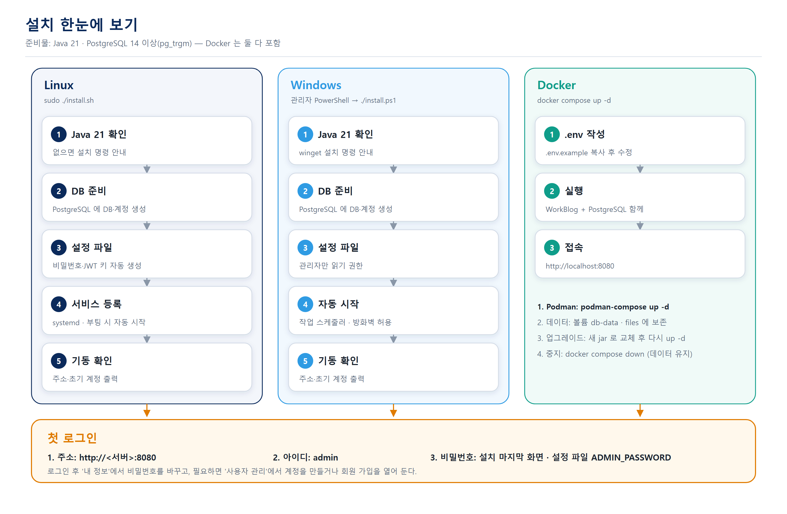
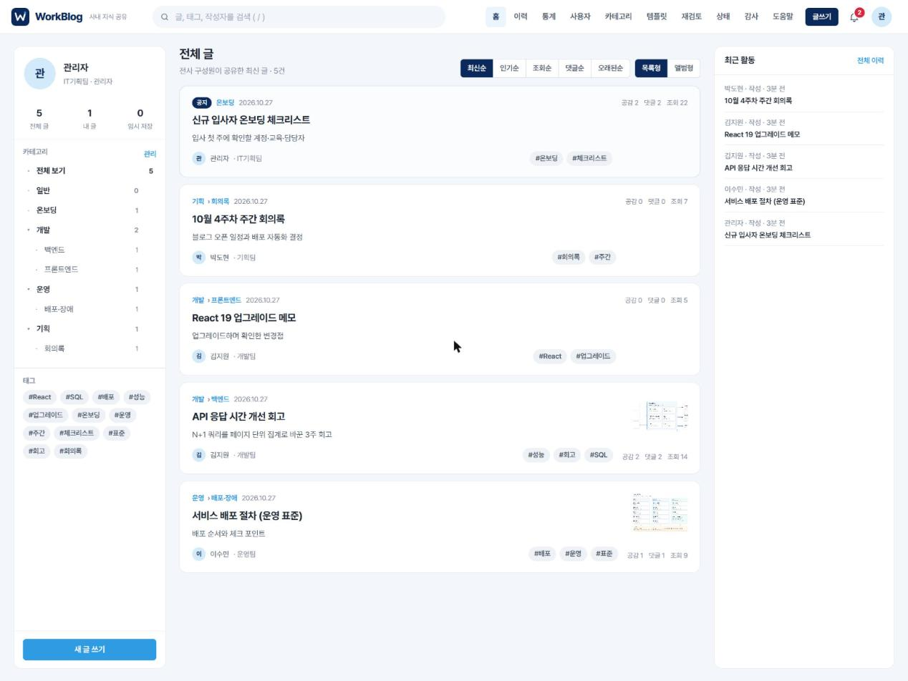
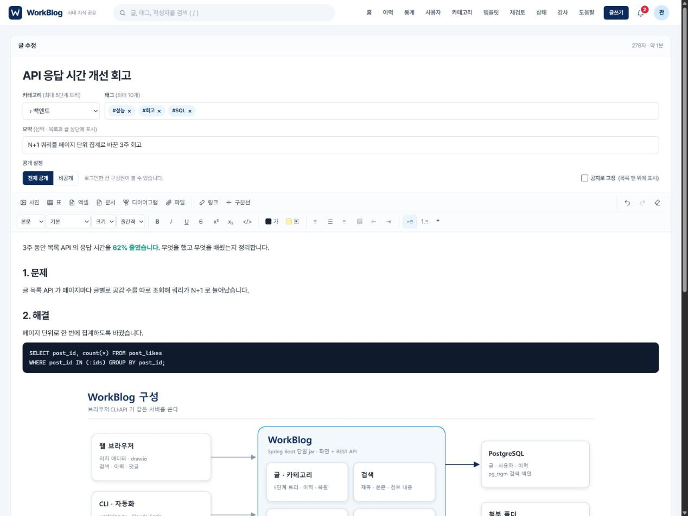
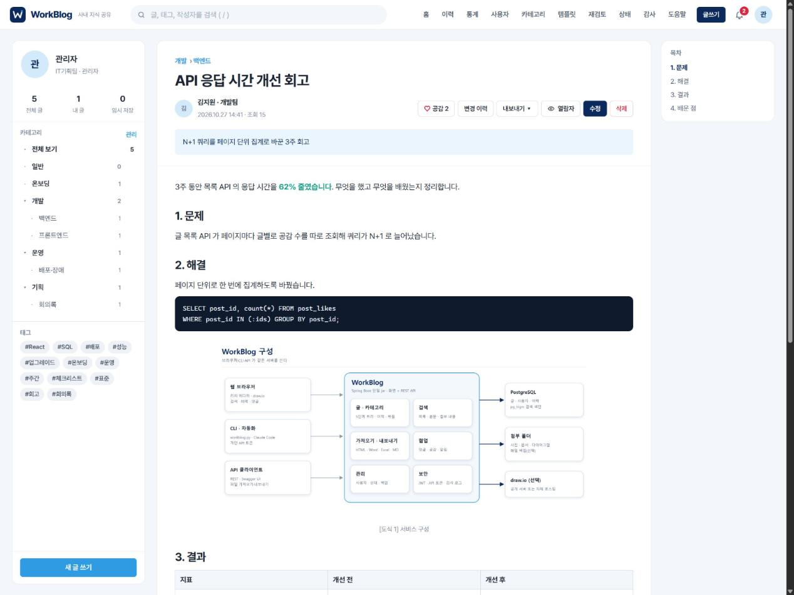
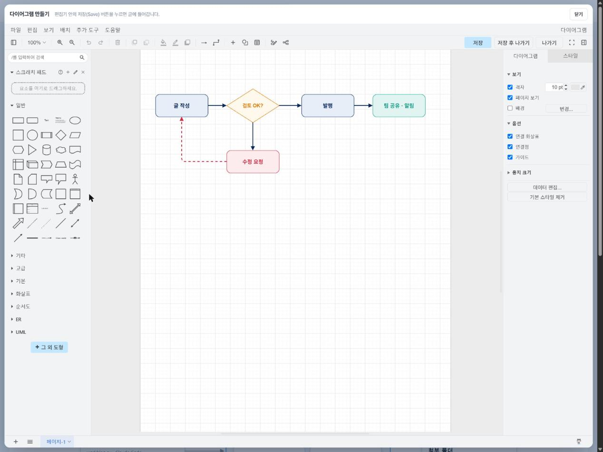
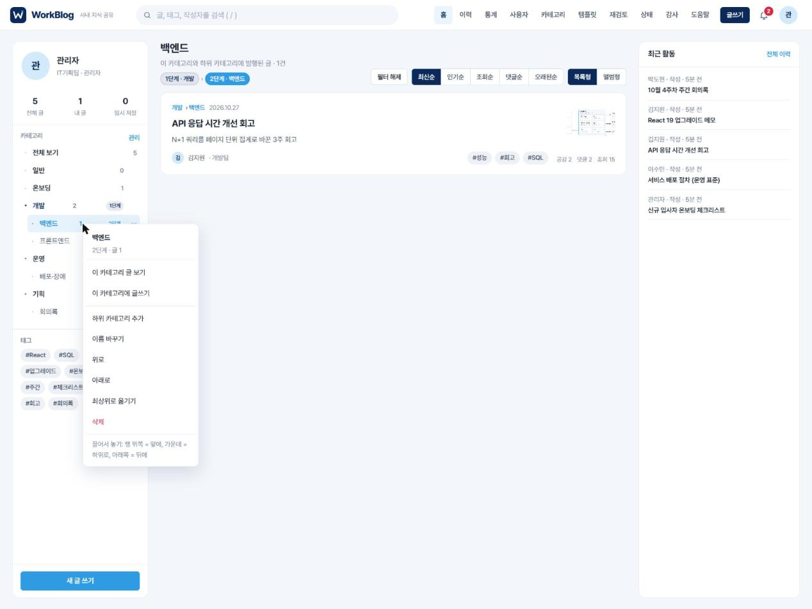
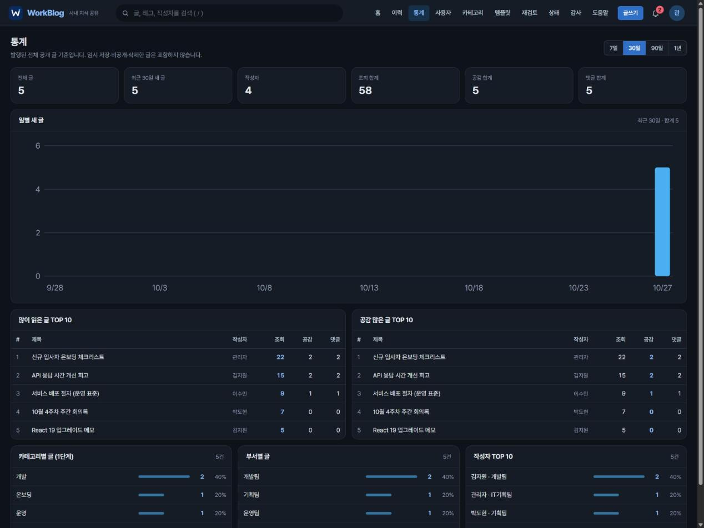
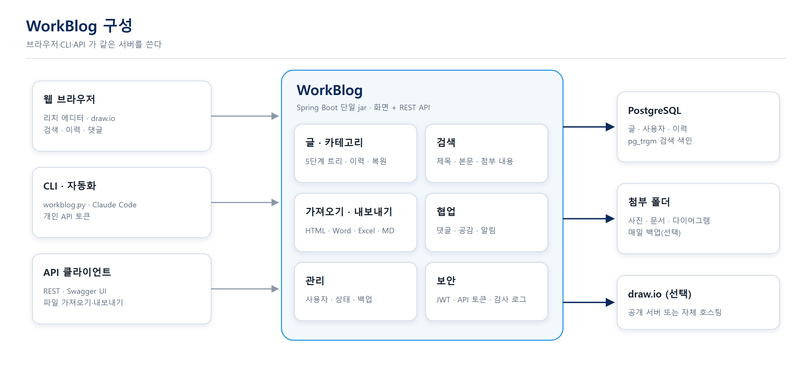

# WorkBlog — 사내 지식 공유 블로그

업무 지식을 블로그처럼 쓰고, 한곳에서 찾고, 이력으로 남기는 시스템입니다. 네이버 블로그와 같은 편집·읽기 경험을 목표로 합니다.



## 1. 빠른 설치

**Ubuntu (인터넷 연결) — 명령 한 줄**

```bash
curl -fsSL https://raw.githubusercontent.com/vavibolivia/workblog/main/install/linux/install.sh | sudo bash
```

1. Java 21 · PostgreSQL 을 apt 로 설치 (DB 가 없어도 됨)
2. 최신 릴리스를 받아 SHA-256 확인
3. DB·계정 생성 → systemd 서비스 등록 → 주소·초기 아이디 `admin`·비밀번호 표시

옵션은 뒤에 붙입니다: `… | sudo bash -s -- --port 8080 --public-url http://서버:8080`. 다시 실행하면 업그레이드(설정·데이터 유지).

**인터넷 없는 서버·다른 배포판** — [Releases](https://github.com/vavibolivia/workblog/releases) 에서 파일을 받아 옮긴 뒤 실행합니다.

| 환경 | 받을 파일 | 실행 |
|---|---|---|
| Linux (systemd) | `workblog-<버전>-linux.zip` 또는 `.tar.gz` | `unzip …` → `cd workblog-<버전>` → `sudo ./install.sh` |
| Docker · Podman | `workblog-<버전>-docker.tar.gz` | `cp .env.example .env` (값 수정) → `docker compose up -d` |

**준비물**
1. Java 21 — Linux `sudo apt install -y openjdk-21-jre-headless`
2. PostgreSQL 14 이상 — 같은 서버에 있으면 설치 프로그램이 DB·계정·`pg_trgm` 확장을 만들어 줍니다
3. Docker 방식은 둘 다 필요 없습니다

**다른 DB 서버를 쓸 때**
```bash
sudo ./install.sh --db-url jdbc:postgresql://db-host:5432/workblog --db-user workblog --db-pass '비밀번호'
```
(그 DB 에 `CREATE EXTENSION pg_trgm;` 이 되어 있어야 합니다.)

## 2. 첫 로그인

| 항목 | 값 |
|---|---|
| 주소 | `http://<서버>:8080` (설치 마지막 화면에 표시) |
| **초기 아이디** | **`admin`** |
| 초기 비밀번호 | 설치 마지막 화면에 한 번 표시 · 설정 파일의 `ADMIN_PASSWORD` (Docker 는 `.env` 의 값) |

1. 로그인 후 오른쪽 위 아바타 → **내 정보** 에서 비밀번호를 바꿉니다.
2. 구성원 계정은 **사용자 관리** 에서 만들거나, 회원 가입(기본 켜짐)으로 각자 만듭니다.
3. 초기 관리자는 사용자가 한 명도 없을 때 한 번만 만들어집니다. 이후 설정 파일의 비밀번호를 바꿔도 계정은 바뀌지 않습니다.

## 3. 사용 화면

> 예시 데이터로 찍은 실제 화면입니다.

| 글 목록 | 글 쓰기 |
|---|---|
|  |  |
| **글 읽기 (목차·첨부·댓글)** | **다이어그램 (draw.io)** |
|  |  |
| **카테고리 메뉴 (우클릭·끌어 옮기기)** | **통계 · 다크 모드** |
|  |  |

## 4. 구성과 기능



1. **글** — 네이버 에디터 수준 서식(글꼴·색·정렬·들여쓰기·표·사진 편집), 임시 저장, 공지, 비공개
2. **분류** — 카테고리 5단계 트리, 우클릭 메뉴, 끌어서 순서·위치 변경
3. **이력** — 모든 수정이 버전으로 남고, 비교·복원 가능
4. **검색·정렬** — 제목·본문·태그·작성자, 최신·인기·조회·댓글순
5. **파일** — HTML·Word·Excel·CSV·Markdown 을 글로 가져오기, HTML·Markdown·Word·PDF(인쇄)로 내보내기
6. **도식** — draw.io 로 그리고 다시 편집
7. **협업** — 댓글·답글, 공감, 회원 가입
8. **연동** — 개인 API 토큰, REST API(Swagger UI), CLI `workblog.py`
9. **운영** — 시스템 상태 화면, 휴지통 자동 정리, 백업 스크립트

## 5. 설정

설정 파일: Linux `/opt/workblog/config/workblog.properties` · Docker `.env`
바꾼 뒤 재시작: Linux `sudo systemctl restart workblog` · Docker `docker compose up -d`

| 키 | 기본값 | 설명 |
|---|---|---|
| `SERVER_PORT` | 8080 | 접속 포트 |
| `DB_URL` · `DB_USERNAME` · `DB_PASSWORD` | 설치 시 생성 | PostgreSQL |
| `JWT_SECRET` | 설치 시 생성 | 32자 이상 |
| `ADMIN_USERNAME` · `ADMIN_PASSWORD` | admin · 설치 시 생성 | 초기 관리자 (사용자가 없을 때만) |
| `PUBLIC_BASE_URL` | 설치 시 추정 | 도움말·CLI 문서에 들어갈 주소 |
| `SIGNUP_ENABLED` · `SIGNUP_APPROVAL` | true · false | 회원 가입 허용 · 관리자 승인제 |
| `STORAGE_DIR` · `MAX_FILE_MB` | 설치 폴더 data/files · 25 | 첨부 저장 위치·최대 크기 |
| `DRAWIO_URL` | 비움(자동) | 비우면 `static-extra/drawio` 가 있을 때 같은 서버의 `/drawio`, 없으면 https://embed.diagrams.net |
| `TRASH_RETENTION_DAYS` · `ORPHAN_ATTACHMENT_HOURS` | 30 · 24 | 휴지통·미연결 첨부 자동 정리 |
| `IMPORT_MAX_MB` · `IMPORT_TMP_DIR` | 2048 · 저장소 옆 imports | 데이터 이전 덤프 올리기 최대 크기·임시 폴더 (첨부 한도와 별개) |

**폐쇄망(인터넷 없음)에서 쓰기** — 글꼴(Pretendard·나눔고딕·나눔명조)은 앱에 들어 있어 외부 주소를 부르지 않습니다. draw.io 만 따로 둡니다: 인터넷이 되는 PC 에서 [jgraph/drawio 릴리스](https://github.com/jgraph/drawio/releases)의 `draw.war` 를 받아 설치 폴더 `static-extra/drawio/` 에 풀면(war 는 zip) `DRAWIO_URL` 을 비워 둔 채로 자동으로 그것을 씁니다.

## 6. 업그레이드·제거

```bash
sudo ./install.sh --upgrade          # 새 버전 압축을 풀고 실행 — 설정·데이터 유지, 이전 jar 는 .bak
sudo ./install.sh --uninstall        # 서비스·프로그램 제거 (설정·데이터·DB 는 남김)
```

## 7. 다른 망으로 옮기기 (데이터 이전)

```
 [원래 서버]                         [옮겨 갈 서버 (예: 폐쇄망)]
 관리자 › 데이터 이전                 관리자 › 데이터 이전
 ① 전체 덤프 받기 ──── .zip ────▶   ② 올리고 미리 보기 → ③ 적용
 ④ 업데이트 덤프 받기 ─ .zip ────▶   ⑤ 올리고 미리 보기 → ⑥ 적용   (변경분이 생길 때마다 ④~⑥)
```

1. 옮겨 갈 서버에 같은 버전의 WorkBlog 를 설치한다 (초기 관리자 `admin`).
2. 원래 서버: **관리자 › 데이터 이전 › 전체 덤프 › 덤프 받기** → `workblog-dump-<인스턴스>-<시각>-full.zip`.
3. 옮겨 갈 서버: 백업(`backup.sh` 등) → **데이터 이전 › 가져오기** 에 zip 을 올려 미리 보기(추가·갱신·건너뜀·충돌) 확인 → **적용**.
4. 그 뒤 변경분: 원래 서버에서 **업데이트 덤프**(기본 기준 = 직전 내보내기 시각) → 같은 방법으로 적용.

- 가져오기는 **병합**입니다. 받는 서버의 데이터를 지우지 않고, 같은 덤프를 두 번 넣어도 결과가 같습니다.
- 받는 서버에서 고친 글은 덮어쓰지 않고 **충돌**로 보고합니다. 사용자는 아이디가 이미 있으면 받는 서버 값을 유지하고, 새 사용자는 원래 비밀번호로 로그인합니다.
- CLI: `workblog.py --user admin --password … dump --full -o 전체.zip` · `load 전체.zip --apply` ([CLI 가이드](backend/docs/CLI_GUIDE.md) 6절).
- 덤프에는 모든 글·첨부 원본·비밀번호 해시가 그대로 들어 있습니다. 사내 반출 절차에 따라 옮기고 보관하세요.

## 8. 문서

| 문서 | 내용 | 앱 안 |
|---|---|---|
| [CLI 가이드](backend/docs/CLI_GUIDE.md) | API 토큰 · `workblog.py` · 자동화 도구 연결 | 도움말 › CLI 가이드 |
| [API 사용 안내](backend/docs/API.md) | REST API 전체 | 도움말 · `/swagger-ui/index.html` |
| [글 작성 지침](backend/docs/WRITING_GUIDE.md) | 공문형 문서·도식·화면 기준 | 도움말 › 글 작성 지침 |

## 9. 개발

| 폴더 | 내용 |
|---|---|
| `backend/` | Spring Boot 3.5 · Java 21 · JPA · Flyway · Spring Security(JWT + API 토큰) |
| `frontend/` | React 19 · TypeScript · Vite · TipTap 3 |
| `backend/docs/` | 사용자 문서(API·CLI·글 작성 지침) — jar 에 넣어 화면 도움말로 제공 |
| `backend/cli/` | CLI `workblog.py` — jar 에 넣어 `/api/guide/workblog.py` 로 제공 |
| `install/` | 빌드 `build.sh`, 릴리스 묶음 `package.py`, Linux 설치(`linux/`)·Docker(`docker/`), 원격 배포·백업·롤백(`deploy/`), 서버 스모크 테스트(`smoke/`) |

```bash
bash install/build.sh                                # 프론트 빌드 → jar 에 포함 (backend/target/*.jar)
python3 install/package.py 0.1.1                     # install/dist/ 에 Linux(tar.gz·zip)·Docker 묶음
DEPLOY_HOST=user@host bash install/deploy/deploy.sh  # 원격 서버 설치 + 서버에서 스모크 테스트
```
`v*` 태그를 올리면 GitHub Actions 가 테스트·빌드 후 Releases 에 묶음을 올립니다.

**복구(원격 podman 운영 예)**
1. 앱: `ssh user@host /project/workblog/rollback.sh [N]`
2. DB: 서비스 중지 → `pg_restore --clean --if-exists -d <db> backup/db/<날짜>.dump`
3. 첨부: `tar -xzf backup/files/files-<날짜>.tar.gz -C <설치 폴더>/data`

제작: 정석호
