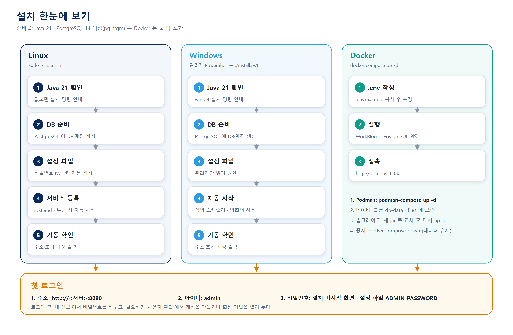
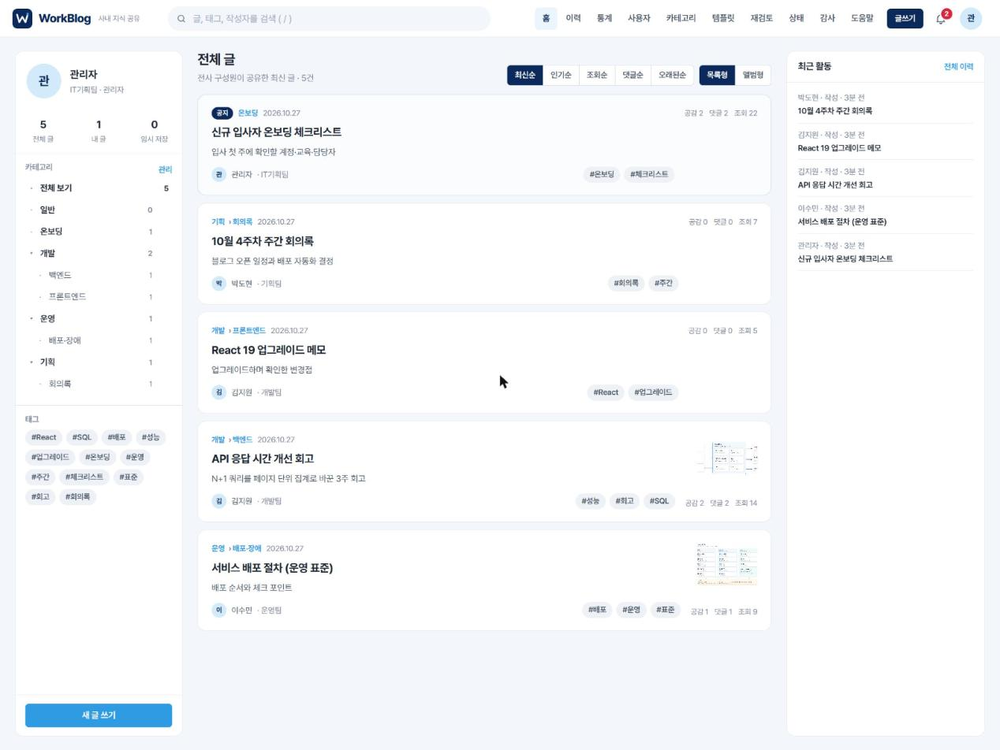
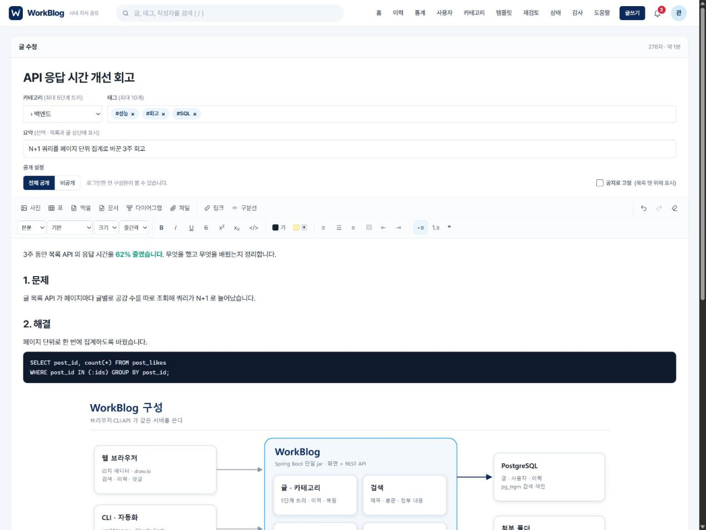
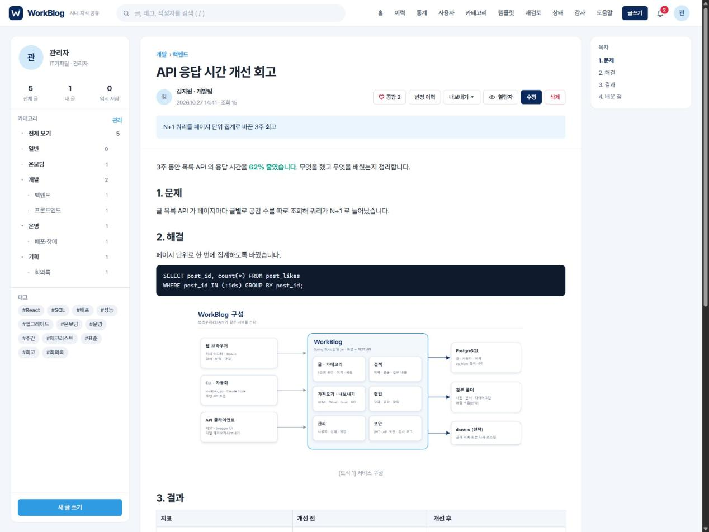
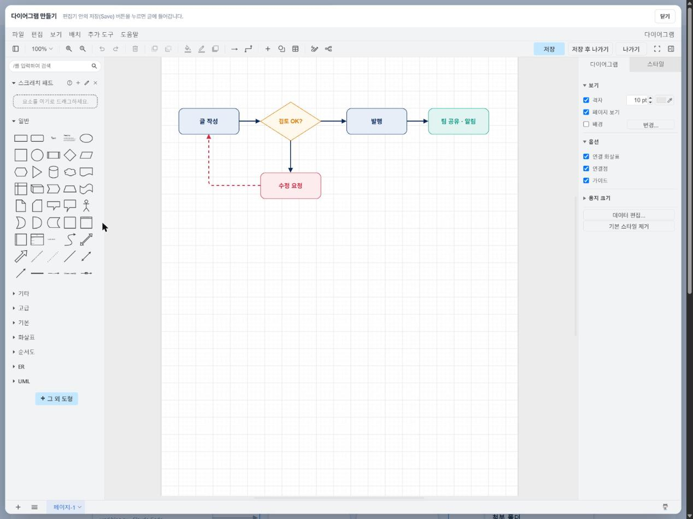
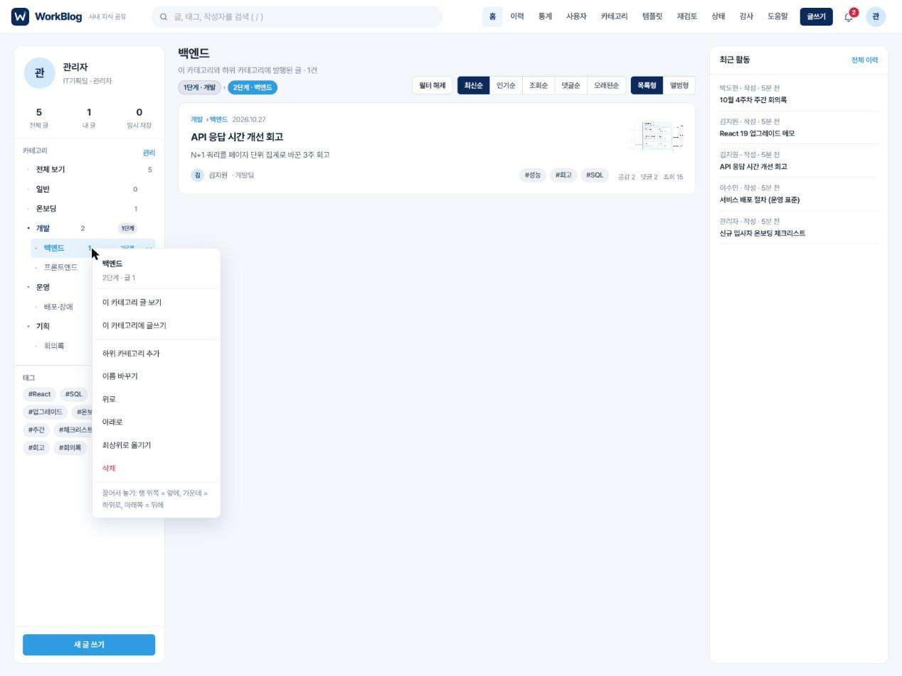
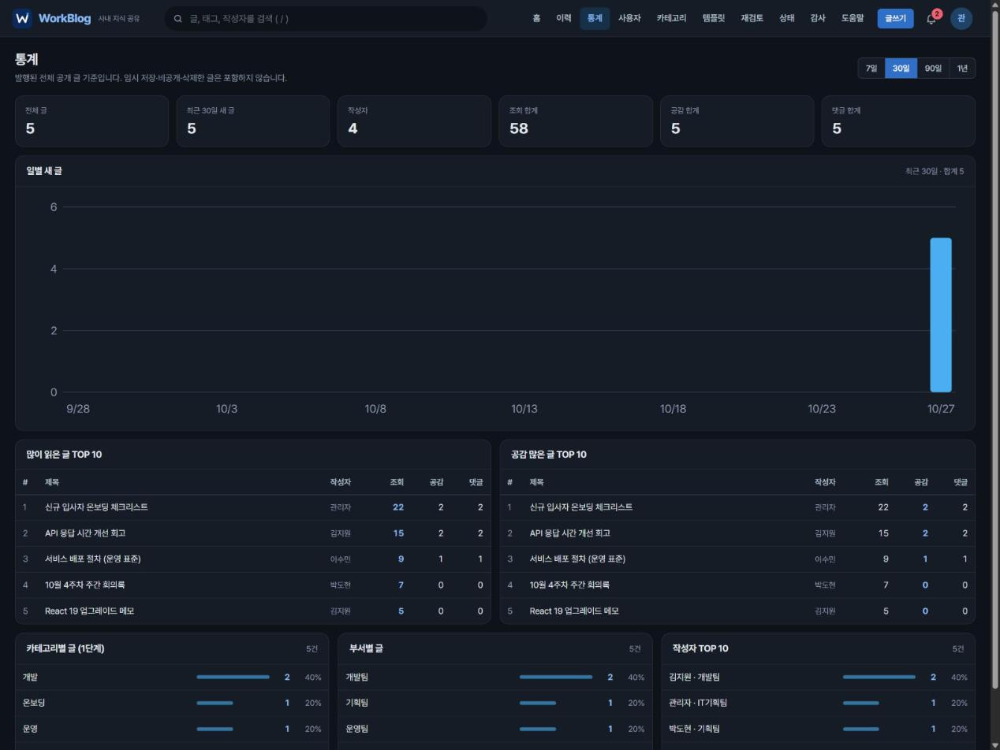
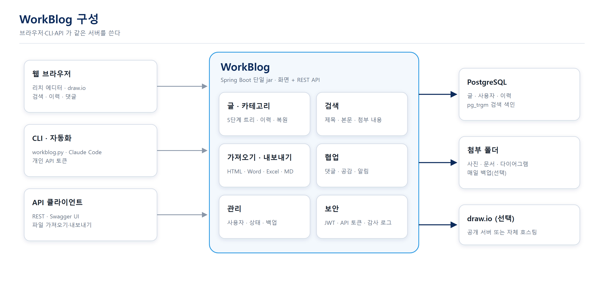

# WorkBlog — 사내 지식 공유 블로그

업무 지식을 블로그처럼 쓰고, 한곳에서 찾고, 이력으로 남기는 시스템입니다. 네이버 블로그와 같은 편집·읽기 경험을 목표로 합니다.



## 1. 빠른 설치

[Releases](https://github.com/vavibolivia/workblog/releases) 에서 운영체제에 맞는 파일을 받아 압축을 풀고 실행합니다.

| 환경 | 받을 파일 | 실행 |
|---|---|---|
| Linux (systemd) | `workblog-<버전>-linux.tar.gz` | `tar xzf …` → `cd workblog-<버전>` → `sudo ./install.sh` |
| Windows | `workblog-<버전>-windows.zip` | 압축 풀기 → 관리자 PowerShell → `.\install.ps1` |
| Docker · Podman | `workblog-<버전>-docker.tar.gz` | `cp .env.example .env` (값 수정) → `docker compose up -d` |

**준비물**
1. Java 21 — Linux `sudo apt install -y openjdk-21-jre-headless` · Windows `winget install Microsoft.OpenJDK.21`
2. PostgreSQL 14 이상 — 같은 서버에 있으면 설치 프로그램이 DB·계정·`pg_trgm` 확장을 만들어 줍니다
3. Docker 방식은 둘 다 필요 없습니다

**다른 DB 서버를 쓸 때**
```bash
sudo ./install.sh --db-url jdbc:postgresql://db-host:5432/workblog --db-user workblog --db-pass '비밀번호'
.\install.ps1 -DbUrl jdbc:postgresql://db-host:5432/workblog -DbUser workblog -DbPassword '비밀번호'
```
(그 DB 에 `CREATE EXTENSION pg_trgm;` 이 되어 있어야 합니다.)

## 2. 첫 로그인

| 항목 | 값 |
|---|---|
| 주소 | `http://<서버>:8080` (설치 마지막 화면에 표시) |
| **초기 아이디** | **`admin`** |
| 초기 비밀번호 | 설치 마지막 화면에 한 번 표시 · 설정 파일의 `ADMIN_PASSWORD` (Docker 는 `.env` 의 값) |

1. 로그인 후 오른쪽 위 아바타 → **내 정보** 에서 비밀번호를 바꿉니다.
2. 구성원 계정은 **사용자 관리** 에서 만들거나, 회원 가입(기본 켜짐)으로 각자 만듭니다.
3. 초기 관리자는 사용자가 한 명도 없을 때 한 번만 만들어집니다. 이후 설정 파일의 비밀번호를 바꿔도 계정은 바뀌지 않습니다.

## 3. 사용 화면

> 예시 데이터로 찍은 실제 화면입니다.

| 글 목록 | 글 쓰기 |
|---|---|
|  |  |
| **글 읽기 (목차·첨부·댓글)** | **다이어그램 (draw.io)** |
|  |  |
| **카테고리 메뉴 (우클릭·끌어 옮기기)** | **통계 · 다크 모드** |
|  |  |

## 4. 구성과 기능



1. **글** — 네이버 에디터 수준 서식(글꼴·색·정렬·들여쓰기·표·사진 편집), 임시 저장, 공지, 비공개
2. **분류** — 카테고리 5단계 트리, 우클릭 메뉴, 끌어서 순서·위치 변경
3. **이력** — 모든 수정이 버전으로 남고, 비교·복원 가능
4. **검색·정렬** — 제목·본문·태그·작성자, 최신·인기·조회·댓글순
5. **파일** — HTML·Word·Excel·CSV·Markdown 을 글로 가져오기, HTML·Markdown·Word·PDF(인쇄)로 내보내기
6. **도식** — draw.io 로 그리고 다시 편집
7. **협업** — 댓글·답글, 공감, 회원 가입
8. **연동** — 개인 API 토큰, REST API(Swagger UI), CLI `workblog.py`
9. **운영** — 시스템 상태 화면, 휴지통 자동 정리, 백업 스크립트

## 5. 설정

설정 파일: Linux `/opt/workblog/config/workblog.properties` · Windows `C:\WorkBlog\config\workblog.properties` · Docker `.env`
바꾼 뒤 재시작: Linux `sudo systemctl restart workblog` · Windows `Stop-ScheduledTask WorkBlog; Start-ScheduledTask WorkBlog` · Docker `docker compose up -d`

| 키 | 기본값 | 설명 |
|---|---|---|
| `SERVER_PORT` | 8080 | 접속 포트 |
| `DB_URL` · `DB_USERNAME` · `DB_PASSWORD` | 설치 시 생성 | PostgreSQL |
| `JWT_SECRET` | 설치 시 생성 | 32자 이상 |
| `ADMIN_USERNAME` · `ADMIN_PASSWORD` | admin · 설치 시 생성 | 초기 관리자 (사용자가 없을 때만) |
| `PUBLIC_BASE_URL` | 설치 시 추정 | 도움말·CLI 문서에 들어갈 주소 |
| `SIGNUP_ENABLED` · `SIGNUP_APPROVAL` | true · false | 회원 가입 허용 · 관리자 승인제 |
| `STORAGE_DIR` · `MAX_FILE_MB` | 설치 폴더 data/files · 25 | 첨부 저장 위치·최대 크기 |
| `DRAWIO_URL` | https://embed.diagrams.net | 폐쇄망이면 자체 호스팅 주소(아래) |
| `TRASH_RETENTION_DAYS` · `ORPHAN_ATTACHMENT_HOURS` | 30 · 24 | 휴지통·미연결 첨부 자동 정리 |

**폐쇄망에서 draw.io 쓰기** — [jgraph/drawio 릴리스](https://github.com/jgraph/drawio/releases)의 `draw.war` 를 설치 폴더 `static-extra/drawio/` 에 풀고 `DRAWIO_URL=http://<서버>:8080/drawio` 로 바꿉니다.

## 6. 업그레이드·제거

```bash
sudo ./install.sh --upgrade          # 새 버전 압축을 풀고 실행 — 설정·데이터 유지, 이전 jar 는 .bak
sudo ./install.sh --uninstall        # 서비스·프로그램 제거 (설정·데이터·DB 는 남김)
```
```powershell
.\install.ps1 -Upgrade
.\install.ps1 -Uninstall
```

## 7. 문서

| 문서 | 내용 | 앱 안 |
|---|---|---|
| [CLI 가이드](docs/CLI_GUIDE.md) | API 토큰 · `workblog.py` · 자동화 도구 연결 | 도움말 › CLI 가이드 |
| [API 사용 안내](docs/API.md) | REST API 전체 | 도움말 · `/swagger-ui/index.html` |
| [글 작성 지침](docs/WRITING_GUIDE.md) | 공문형 문서·도식·화면 기준 | 도움말 › 글 작성 지침 |

## 8. 개발

| 폴더 | 내용 |
|---|---|
| `backend/` | Spring Boot 3.5 · Java 21 · JPA · Flyway · Spring Security(JWT + API 토큰) |
| `frontend/` | React 19 · TypeScript · Vite · TipTap 3 |
| `install/` | Linux·Windows 설치 스크립트, Docker 구성 |
| `scripts/` | CLI `workblog.py`, 릴리스 묶음 `package.py`, 서버 스모크 테스트 |
| `deploy/` | 원격 서버 배포·백업·롤백 스크립트 (podman 운영 예) |

```bash
bash build.sh                                        # 프론트 빌드 → jar 에 포함 (backend/target/*.jar)
python3 scripts/package.py 0.1.0                     # dist/ 에 Linux·Windows·Docker 묶음
DEPLOY_HOST=user@host bash deploy/deploy.sh          # 원격 서버 설치 + 서버에서 스모크 테스트
```
`v*` 태그를 올리면 GitHub Actions 가 테스트·빌드 후 Releases 에 묶음을 올립니다.

**복구(원격 podman 운영 예)**
1. 앱: `ssh user@host /project/workblog/rollback.sh [N]`
2. DB: 서비스 중지 → `pg_restore --clean --if-exists -d <db> backup/db/<날짜>.dump`
3. 첨부: `tar -xzf backup/files/files-<날짜>.tar.gz -C <설치 폴더>/data`

제작: 정석호
